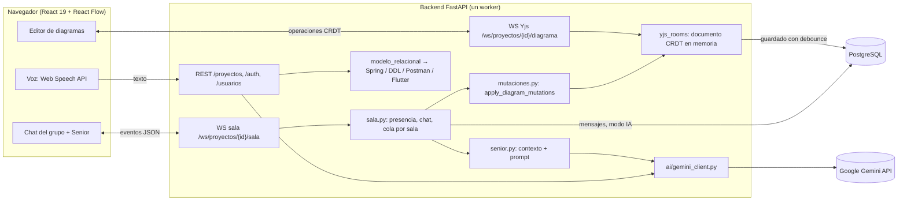

# Documentación técnica — Segundo parcial

Plataforma colaborativa de diagramas de clases UML con un Desarrollador Senior de IA (Google Gemini).

El grupo no está fijo en el código: cada usuario se registra con su nombre personal y el nombre de su grupo, y la interfaz muestra siempre el grupo de quien está conectado.

## 1. Arquitectura



| Capa | Tecnología |
|---|---|
| Frontend | React 19, TypeScript, Vite, React Flow 11, Yjs + y-websocket |
| Backend | FastAPI, SQLAlchemy 2, Alembic, pycrdt-websocket, `google-genai` |
| Base de datos | PostgreSQL |
| Backend generado | Spring Boot 3.2, JPA, Flyway, springdoc-openapi, Docker Compose |

**Fuente de verdad del diagrama.** El servidor mantiene el documento Yjs de cada proyecto y lo persiste en las tablas normalizadas. Cada edición viaja como una operación atómica del CRDT (por ejemplo, el `pos_x` de una clase), no como el diagrama entero.

El CRDT garantiza que todos los clientes converjan al mismo estado aunque editen a la vez, así que dos usuarios no pueden terminar viendo diagramas distintos. Al conectarse o reconectarse, el protocolo de sincronización de Yjs entrega el estado completo; además, la sala envía `DIAGRAM_SNAPSHOT` con un contador `version`.

Las mutaciones del Senior se validan y se aplican en el servidor, dentro de ese mismo documento. Desde ahí llegan a todas las pantallas como cualquier cambio remoto.

## 2. Protocolo de eventos de la sala (una por grupo)

Hay **una sala por grupo**: todos los proyectos del grupo comparten el mismo chat. Se entra desde un proyecto, que es el contexto del Senior para lo que se pregunta desde esa conexión; cada mensaje trae `proyecto: {id, nombre}` y la presencia indica en qué proyecto está cada integrante.

WebSocket: `wss://<host>/api/ws/proyectos/{id}/sala?token=<JWT>`. Cada mensaje es `{"type": "...", "payload": {...}, "timestamp": "ISO-8601"}`.

Se valida el acceso antes de aceptar la conexión: puede entrar el dueño del proyecto, un colaborador activo o un integrante del mismo grupo. Si no, se cierra con un código: `4401` (sin token), `4403` (sin acceso) o `4404` (el proyecto no existe).

### Del cliente al servidor

| Evento | Payload | Efecto |
|---|---|---|
| `CHAT_MESSAGE` | `{texto, preguntar_senior}` | Guarda el mensaje y lo difunde. Si menciona al Senior (`@senior`, "Senior, …") o trae `preguntar_senior: true`, lo pone en la cola del Senior |
| `AI_ACTION_DECISION` | `{mensaje_id, aprobar}` | Aplica o rechaza una propuesta (modo con confirmación) |
| `SET_AI_MODE` | `{modo}` | Cambia el modo: `consultivo`, `con_confirmacion` o `automatico` |
| `SYNC_REQUEST` | `{}` | Pide de nuevo el historial y el snapshot |
| `PING` | `{}` | El servidor responde `PONG` |

### Del servidor al cliente

| Evento | Payload |
|---|---|
| `WELCOME` | `{usuario, grupo, modo_ia}` |
| `CHAT_HISTORY` | `{mensajes: Mensaje[]}` (los últimos 200) |
| `DIAGRAM_SNAPSHOT` | `{diagrama, version}` |
| `PRESENCE_LIST` | `{usuarios: [{id, nombre}]}` |
| `USER_JOINED` / `USER_LEFT` | `{usuario}` |
| `CHAT_MESSAGE` / `CHAT_MESSAGE_UPDATED` | `{mensaje}` |
| `AI_TYPING` | `{activo, para, en_cola}` |
| `AI_DIAGRAM_ACTION_PROPOSED` | `{mensaje_id, resumen[], acciones[]}` |
| `AI_DIAGRAM_ACTION_EXECUTED` | `{mensaje_id, resumen[], version, diagrama, por}` |
| `AI_DIAGRAM_ACTION_REJECTED` | `{mensaje_id, por}` |
| `AI_MODE_CHANGED` | `{modo, por}` |
| `ERROR` | `{mensaje}` |

Forma de un `Mensaje`:

```json
{"id": 12, "autor": {"id": 3, "nombre": "Juan"}, "tipo": "humano | senior_ai | sistema",
 "texto": "...", "fecha": "2026-11-09T22:49:00+00:00",
 "dirigido_a": {"id": 3, "nombre": "Juan"},
 "propuesta": {"acciones": [], "resumen": ["Se crea la clase ..."], "estado": "pendiente | aplicada | rechazada | fallida", "decidida_por": "María"}}
```

El cliente (`frontend/src/collab/useSala.ts`) se reconecta solo, con backoff exponencial de hasta 15 s.

## 3. El Desarrollador Senior

- **Contexto de cada llamada** (`backend/app/services/senior.py`):
  - el system prompt;
  - el nombre del grupo;
  - el JSON actual del diagrama, con ids;
  - el resumen de los mensajes viejos;
  - los últimos 30 mensajes como `[Autor]: texto`;
  - el nombre y el id de quien pregunta.
- **Respuestas dirigidas**: el prompt exige empezar por el nombre de quien preguntó, y `asegurar_saludo` lo verifica y antepone `@Nombre,` si el modelo no lo hizo (RF-IA-04).
- **Cola por sala** (RF-IA-07): un solo worker procesa las preguntas en orden. Cada una lleva su propio contexto; no se incluyen preguntas humanas posteriores, sí las respuestas del Senior.
- **Historial largo**: cuando hay más de 60 mensajes sin resumir, los que quedan fuera de la ventana se resumen con Gemini y el resumen se guarda en el proyecto.
- **Modos (RF-IA-09)**, visibles y editables en el panel del chat:

| Modo | Comportamiento |
|---|---|
| Consultivo | Al modelo no se le ofrece la herramienta: solo explica y sugiere |
| Con confirmación | Emite `AI_DIAGRAM_ACTION_PROPOSED`. La tarjeta muestra la vista previa con **Aplicar / Rechazar**; al aplicar se re-valida contra el diagrama actual |
| Automático (por defecto) | Aplica directo y lo explica |

### Herramienta `apply_diagram_mutations`

Definida en `backend/app/services/mutaciones.py` (`ESQUEMA_HERRAMIENTA`). Todas sus propiedades son explícitas, porque Gemini rechaza los objetos sin `properties`.

```json
{
  "mensaje": "María, agregué DetalleFactura ...",
  "acciones": [
    {"action": "ADD_ENTITY", "tempId": "t1",
     "entityData": {"name": "DetalleFactura", "isAbstract": false,
                    "attributes": [{"name": "cantidad", "type": "int", "visibility": "private"}]}},
    {"action": "ADD_RELATIONSHIP",
     "relationshipData": {"sourceId": "Factura", "sourceCardinality": "1",
                          "targetId": "t1", "targetCardinality": "1..*",
                          "type": "composition", "label": null, "associationClassId": null}}
  ]
}
```

- **Acciones**: `ADD|UPDATE|DELETE` × `ENTITY|ATTRIBUTE|RELATIONSHIP`.
- **Referencias**: `entityId` acepta un id real, un `tempId` del mismo lote o el nombre de la clase. Cada `tempId` se traduce a un uuid real.
- **Tipos de atributo**: `String`, `int`, `long`, `double`, `decimal`, `boolean`, `date`, `datetime` y `uuid`. También se aceptan sinónimos SQL como `varchar`, `integer`, `numeric` o `timestamp`.
- **Cardinalidades**: `1`, `0..1`, `*`, `0..*`, `1..*`.
- **Atomicidad**: el lote se aplica sobre una copia y se valida al final. Si algo falla, no cambia nada y el Senior lo informa en el chat.
- **Ubicación**: las clases nuevas van a celdas libres de una grilla, sin encimarse con otras.
- **Orientación**: una composición o agregación enviada al revés (el todo con `*`) se corrige de forma determinística.

## 4. Configuración de Gemini

Solo el backend conoce la key; el frontend nunca llama a Gemini.

```env
GEMINI_API_KEY=...                         # https://aistudio.google.com/apikey
GEMINI_MODEL=gemini-3.5-flash              # texto + tool calling (Senior, comandos de voz/texto)
GEMINI_VISION_MODEL=gemini-3.5-flash       # importar diagramas desde imagen
GEMINI_FALLBACK_MODEL=gemini-3.1-flash-lite  # respaldo si el principal responde 429/503
```

- **Dónde va**: toda la configuración (key de Gemini, base de datos, JWT) vive en los `.env`:
  - en desarrollo, en `backend/.env` (base `diagramador_parcial2` del contenedor `pg_diagramador_dev`, puerto 5433);
  - con Docker, en `.env` de la raíz (base `diagramador_parcial2` del contenedor `db`).
  - Plantillas: `backend/.env.example` y `.env.produccion.example`.
- **Cliente único**: `backend/app/services/ai/gemini_client.py`, con `chat_with_tools`, `parse_command`, `image_to_diagram`, `generate_json` y `generate_text`.
- **Errores 429 y 5xx**: hasta 3 reintentos con backoff exponencial y luego el modelo de respaldo. Si sigue fallando, muestra un mensaje claro en el chat o en la interfaz.

## 5. Cómo ejecutar

**Con Docker** (todo junto, con HTTPS local):

```powershell
copy .env.produccion.example .env   # completar POSTGRES_PASSWORD, SECRET_KEY, GEMINI_API_KEY; DOMINIO=localhost
docker compose up --build -d
docker compose exec backend python -m app.seed   # admin@diagramador.com / admin12345 (grupo "Grupo Demo")
# abrir https://localhost
```

**En desarrollo**:

```powershell
# backend/
python -m venv venv; venv\Scripts\activate; pip install -r requirements.txt
alembic upgrade head; python -m app.seed
uvicorn app.main:app --reload            # http://localhost:8000/docs
# frontend/
npm install; npm run dev                 # http://localhost:5173
```

**Backend generado** (botón *Archivo → Generar Backend y APIs*): descomprimir el `.zip` y correr `docker compose up --build`. Levanta PostgreSQL y la API en http://localhost:8080. Swagger UI queda en `/swagger-ui.html`, y la colección de Postman es `postman_collection.json`.

## 6. Cómo probar cada escenario

Preparación: registrar dos usuarios con el **mismo nombre de grupo** (después pueden entrar con *nombre + grupo + contraseña*) (por ejemplo "Juan" y "María"). Juan crea un proyecto con la clase `Factura`. Los dos lo abren en navegadores distintos (María lo ve en su lista porque es del mismo grupo).

| Escenario | Pasos | Qué se espera |
|---|---|---|
| **7.1 Atributo derivado** | Juan escribe `@senior ¿qué es un atributo derivado?` | Los dos navegadores muestran el mensaje, el indicador "Senior está escribiendo…" y la misma respuesta, que empieza con "Juan, …" e incluye definición y ejemplo |
| **7.2 Factura → DetalleFactura** | María escribe `Senior, agrega la clase DetalleFactura relacionada con Factura, con cantidad y precioUnitario` | La respuesta va dirigida a María. `DetalleFactura` y la composición `Factura 1 ◆── 1..* DetalleFactura` aparecen en los dos lienzos |
| **Seguimiento contextual** | Juan escribe `@senior ¿Y si le agregamos teléfono a la clase anterior?` | Se agrega `telefono` a `DetalleFactura` |
| **Modo con confirmación** | María cambia el modo; Juan pide un cambio | Aparece una propuesta con Aplicar / Rechazar; al aplicarla se actualizan los dos lienzos |
| **7.3 Backend generado** | Generar el backend, `docker compose up --build` e importar `postman_collection.json` en Postman → *Run collection* | Todas las peticiones dan 200/201/204. Las de integridad referencial dan 400 (id inexistente) y 409 (borrar un registro referenciado) |
| **N:M** | Diagrama `Estudiante *—* Curso`, generar el backend | Se crea la tabla `cursos_estudiantes` con PK compuesta y `ON DELETE CASCADE`. En Postman funcionan `POST`, `GET` y `DELETE /api/estudiantes/{id}/cursos/{cursoId}` |
| **Edición simultánea** | Juan y María mueven y editan clases a la vez | Los dos lienzos convergen al mismo estado (CRDT) |
| **Persistencia** | Todos cierran y vuelven a entrar | El tablero y la conversación siguen ahí |

### Verificación automatizada

```powershell
cd backend; venv\Scripts\activate; pytest -q
```

Gemini siempre está mockeado en los tests. Los archivos principales:

| Archivo | Qué cubre |
|---|---|
| `tests/test_sala.py` | Sala con dos clientes WebSocket reales: broadcast, presencia, escenarios 7.1/7.2, propuestas, cola en orden, modos, persistencia |
| `tests/test_mutaciones.py` | Lotes atómicos, `tempId`, validaciones, ubicación libre |
| `tests/test_generador_nm.py` | DDL con tabla intermedia, herencia JOINED, rutas N:M, Postman, Flutter, formatos DDL/JSON |
| `tests/test_gemini_client.py` | Traducción de esquemas a Gemini, reintentos y respaldo ante 429/503 |
| `tests/test_grupos.py` | Registro con grupo, tableros compartidos y acceso |

Verificaciones manuales hechas durante el desarrollo (con Gemini real):

- Un guion de Playwright con dos navegadores: 21/21 chequeos de los escenarios de arriba.
- El backend generado compilado con Maven y probado con newman sobre H2 y sobre PostgreSQL 17: 92/92 aserciones.
